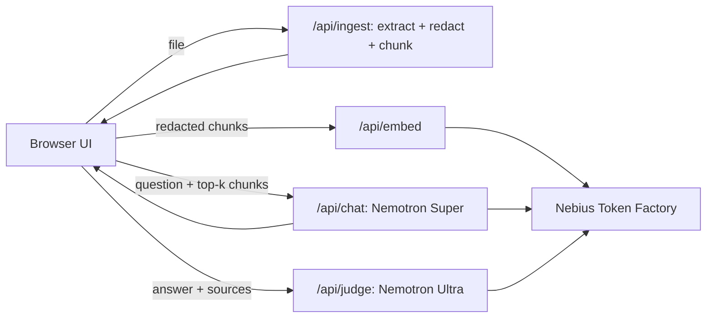

# VaultAI

**Ask questions about sensitive documents without leaking them.** PII is redacted before any model sees the text, NVIDIA Nemotron on Nebius Token Factory answers with citations, a second Nemotron model checks every answer claim by claim, and you can see exactly what was sent to the model.

Built for the **Nebius x NVIDIA Global AI Hackathon**, track: **Best Apps and Agents**.

- Live demo: `TODO: add URL`
- Demo video: `TODO: add YouTube link`
- License: MIT

---

## The problem

Teams in healthcare, finance and legal want to use AI on their documents, but they cannot paste patient records or loan files into a system they cannot inspect. Most "private AI" tools simply ask you to trust them. VaultAI lets you check.

## What it does

1. **Redacts before anything reaches a model.** Uploaded `.txt` and `.pdf` files are scanned for names, SSNs, emails, phone numbers, addresses, IBANs, card numbers, dates and labelled IDs. Each value becomes a consistent placeholder such as `[PERSON_1]`, so the model can still reason about "the same person" without knowing who it is. Redaction runs on our server first; only redacted text is ever sent to a model.
2. **Shows you the result before it is used.** A side-by-side preview (original vs. redacted) lets a person approve a document.
3. **Answers with citations.** Questions are answered by Nemotron Super from the most relevant redacted passages, with `[1]`-style citations.
4. **Verifies every answer.** Nemotron Ultra acts as an independent judge. It splits the answer into claims and marks each one as supported or unsupported by the sources. If the first check scores low, the answer can be regenerated once with a stricter prompt and re-checked, keeping the better result.
5. **Shows its work.** A Wire Inspector displays the exact payload sent to the model for each request, an audit log records what was queried and when, and a Purge button clears the session and returns a receipt. *(The audit log, wire records and purge receipt are implemented in `lib/audit.ts`; the Privacy tab UI is in progress.)*

User questions are redacted too, so personal data typed into the chat box does not reach the model either.

## Architecture



Session data (redacted chunks, vectors, audit log) lives **in the browser**. The server is stateless: it processes a request and forgets it. That keeps the privacy story simple, avoids serverless timeouts, and makes "Purge" mean something real.

## How we use NVIDIA Nemotron and Nebius Token Factory

| Role | Model on Token Factory | Why |
|---|---|---|
| Fast helper calls | `nvidia/NVIDIA-Nemotron-3-Nano-30B-A3B` | Cheapest and quickest. Cleans up the question into a short search query (`/api/rewrite`), in parallel with embedding. Used only when the document set is large enough that we search instead of sending every passage. |
| Grounded answers | `nvidia/nemotron-3-super-120b-a12b` | Good instruction following at low latency (about 1 to 1.4 s per answer in our tests). |
| Answer verification (judge) | `nvidia/Nemotron-3-Ultra-550b-a55b` | Strongest reasoning, used as an independent auditor of each answer. |
| Embeddings | `Qwen/Qwen3-Embedding-8B` | The only embedding model listed on Token Factory when we built this. It is not an NVIDIA model. Generation and judging are all Nemotron. |

### Where Token Factory accelerated our workflow

- **OpenAI-compatible API.** We used the standard `openai` package and only changed the base URL, so integration took minutes.
- **Several Nemotron sizes behind one API.** We route each task to the smallest model that does it well, instead of running everything on one large model.
- **Low per-token prices.** A full question (retrieve, answer, judge) cost well under a cent in our tests, so we could run evaluations repeatedly.
- **Embedding `dimensions` parameter.** We request 512 instead of the default 4,096 dimensions, which keeps browser-side retrieval payloads small.
- `TODO: add measured numbers from the final eval run (latency, cost per question).`

## Evaluation

`TODO: after the eval run, paste the results table here.`

We test with three synthetic documents (clinic intake, clinic visit summary, billing statement) and 10 questions: 7 answerable from the documents and 3 traps (an answer that is not in the documents, an attempt to extract a redacted value, and an ambiguous question). We also give the judge 3 deliberately wrong answers (`docs/eval/planted-wrong.json`) and check that it does not mark them verified. Run it with `node --env-file=.env.local scripts/eval.mjs`. Results are in `docs/eval/results.md`.

## Run it locally

Requirements: Node.js 22.18 or newer (the scripts load the TypeScript files in `lib/` directly).

```bash
git clone https://github.com/Zainamrj/vaultai.git
cd vaultai
npm install
```

Create `.env.local` in the project root:

```
MOCK_AI=true
NEBIUS_API_KEY=
NEBIUS_BASE_URL=https://api.tokenfactory.nebius.com/v1/
MODEL_FAST=nvidia/NVIDIA-Nemotron-3-Nano-30B-A3B
MODEL_MAIN=nvidia/nemotron-3-super-120b-a12b
MODEL_JUDGE=nvidia/Nemotron-3-Ultra-550b-a55b
MODEL_EMBED=Qwen/Qwen3-Embedding-8B
```

Then:

```bash
npm run dev
```

and open http://localhost:3000.

**Mock mode.** With `MOCK_AI=true` the app uses fake embeddings, a placeholder answer and a placeholder judge result, so you can try the interface and the redaction without an API key or any cost. For real answers, create a key in the [Token Factory console](https://tokenfactory.nebius.com), put it in `NEBIUS_API_KEY`, and set `MOCK_AI=false`.

Model IDs change over time. To list the models available to your key:

```bash
node --env-file=.env.local scripts/list-models.mjs
```

Run all offline checks (type-check, lint, unit tests; no API key, no network):

```
npm run check
```

Smoke-test the API routes (mock mode only, so it cannot spend credits). Start the server in one terminal, run the test in another:

```
MOCK_AI=true npm run dev
npm run smoke
```

To run the whole pipeline once against the real models (about a cent):

```bash
node --env-file=.env.local scripts/full-pipeline-test.mjs
```

## Project structure

```
app/api/ingest   upload, text extraction, redaction, chunking
app/api/embed    embeddings via Token Factory
app/api/chat     grounded, cited, streamed answers
app/api/judge    claim-by-claim verification (optional one-time regeneration)
app/api/rewrite  query cleanup with Nemotron Nano
lib/redact.ts    PII detection and placeholder mapping
lib/chunk.ts     paragraph-first chunking with overlap
lib/ai.ts        Token Factory client with a mock mode
lib/prompts.ts   every prompt, shared by the API, the Wire Inspector and the eval
lib/audit.ts     hash-chained audit log, wire records, purge receipt
scripts/         model listing, end-to-end test, eval harness, unit tests
Dockerfile.eval  runs the eval as a container / Nebius Serverless Job (docs/serverless-job.md)
docs/            test documents, eval questions and results
```

## Limitations

We would rather be clear about what this prototype does not do.

- **Redaction is rule-based, so it is not perfect.** It uses patterns and label heuristics (for example `Patient:` or `Dr.`). A name written in plain prose with no label or title, such as "Maria Garcia-Lopez saw the doctor", is not caught. Organizations are only caught after labels like `Employer:`. This is why the preview step exists: a person reviews the result before a document is used.
- **User questions are redacted with the same rules.** It catches SSNs, emails, phone numbers, IBANs and anything with a label or honorific. It does not catch a bare name typed into a question.
- **Dollar amounts are deliberately not redacted**, so questions about loan or billing figures still work.
- **Scanned (image-only) PDFs are not supported.** There is no OCR.
- **The judge is a model, so it can be wrong.** It reduces unsupported answers but does not guarantee zero hallucination.
- **Embeddings are not NVIDIA models.** Embeddings use Qwen3-Embedding-8B because it was the only embedding model on Token Factory at build time.
- **Demo data is synthetic.** Do not upload real personal data to a demo deployment.

## Team

- `TODO: names and roles`

## License

MIT. See [LICENSE](LICENSE).